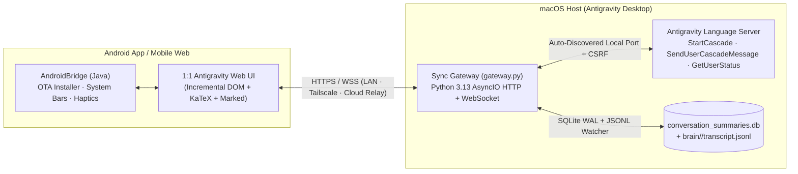

# Antigravity Mobile (Android & Web 1:1 Companion for Antigravity Desktop)

<p align="center">
  <strong>Real-time Mobile & Web Sync Gateway + Native Android App for Google Antigravity 2.0</strong><br/>
  Zero-dependency Python 3.13 AsyncIO Server · RFC 6455 WebSocket Live Streaming · 1:1 Desktop UI · In-App OTA Updates
</p>

---

## ✨ Features / 核心特性

- **🔄 100% Real-Time Bi-Directional Sync (桌面端与移动端毫秒级双向同步)**
  - Directly monitors Antigravity's SQLite index (`conversation_summaries.db` + FTS5) and live JSONL transcripts (`brain/<id>/.system_generated/logs/transcript.jsonl` + `transcript_full.jsonl`).
  - Streams live **Thinking**, **Tool Calls**, **File Diffs**, and **Markdown + KaTeX Responses** over WebSocket in real time.
  - Injects mobile messages directly into the running Antigravity Desktop Language Server (`StartCascade` + `SendUserCascadeMessage`) with zero extra setup.

- **⏳ Queued Messages Waiting Area (任务运行中消息排队等候区)**
  - Send follow-up prompts while an agent task is actively running — messages automatically enter the **Queued Messages** tray and dequeue as soon as the current turn completes, or can be forced immediately (`Send now`), edited (`Edit`), or removed (`×`).

- **📊 Live Model Quota Rings & Usage Modal (1:1 桌面端模型剩余额度圆环与重置倒计时)**
  - Queries live `GetUserStatus` from the Antigravity Language Server to display real-time circular quota progress rings (`>=25%` green, `10–25%` amber, `<10%` red), remaining percentages, and reset countdowns across the top header, sidebar, inline composer, and model picker.

- **🗂️ Project Folder Routing & Conversation Management (项目文件夹归属与对话管理)**
  - Create conversations directly inside any Project folder (`StartCascade` `projectEnvConfig`), or manage existing conversations from the sidebar (`Rename`, `Move to Project Folder`, `Delete`).

- **🖼️ Multimodal Photo/Video Uploads & Streaming Downloads (手机相册图片/视频上传与流式下载)**
  - Pick photos, `.heic` live photos (auto-converted via macOS `sips`), videos, or arbitrary files from your phone gallery/filesystem and attach them as native multimodal `media` items.
  - 256KB chunked HTTP range streaming for smooth mobile `<video>` playback and native Android streaming downloads (`downloadFileFromUrl`).

- **📲 Built-In Android OTA Self-Update (安卓端内置一键覆盖更新)**
  - Includes a custom `FileProvider` (`ApkProvider`) and native package installer bridge (`installApkBase64` / `downloadFileFromUrl`) so new APK builds push an instant update pill over WebSocket and install in-place with one tap.

---

## 🏗️ Architecture / 架构概览



---

## 🚀 Quick Start / 快速开始

### 1. Start the Sync Gateway on macOS

No third-party Python packages are required (100% Python 3 standard library):

```bash
git clone https://github.com/Z-2510P/antigravity-mobile.git
cd antigravity-mobile
cp .env.example .env

# Run the gateway on port 8899
python3 server/gateway.py
```

Once started, open `http://<your-mac-lan-ip>:8899` in any desktop or mobile browser.

### 2. Optional: Configure Background Auto-Start (`launchd`) or Cloud Relay

Edit `.env` to configure your custom port or an optional SSH reverse tunnel relay:

```ini
AGY_MOBILE_HOST=0.0.0.0
AGY_MOBILE_PORT=8899
AGY_VPS_SSH_HOST=your-vps-ssh-alias
AGY_VPS_PUBLIC_URL=https://your-domain-or-ip
```

### 3. Build the Native Android APK from Source

Requirements:
- OpenJDK 17 (`/opt/homebrew/opt/openjdk@17`)
- Android SDK Build-Tools `35.0.0` & Platform `android-34` (`/opt/homebrew/share/android-commandlinetools`)

```bash
bash android/build_apk.sh
```

The signed APK is output to `dist/AntigravityMobile.apk` and automatically served at `GET /download/AntigravityMobile.apk`.

---

## 📁 Project Structure / 目录结构

```text
antigravity-mobile/
├── .env.example                 # Environment variable template
├── LICENSE                      # MIT License
├── README.md                    # Documentation
├── server/
│   ├── gateway.py               # Zero-dependency Python 3.13 HTTP + WebSocket Sync Gateway
│   └── web/
│       └── index.html           # 1:1 Antigravity Mobile & Web Frontend
├── android/
│   ├── AndroidManifest.xml      # Android app manifest (minSdk 24, targetSdk 34)
│   ├── build_apk.sh             # One-click APK build & signing script (aapt2 + javac + d8 + apksigner)
│   ├── res/                     # Adaptive launcher icons, strings, network security config
│   └── src/com/antigravity/mobile/
│       ├── MainActivity.java    # WebView host, AndroidBridge, OTA APK installer, streaming downloader
│       └── ApkProvider.java     # Zero-dependency content:// FileProvider for Android 7–14 package install
└── dist/
    └── AntigravityMobile.apk    # Compiled & signed Android package
```

---

## 📄 License

Released under the [MIT License](LICENSE).
